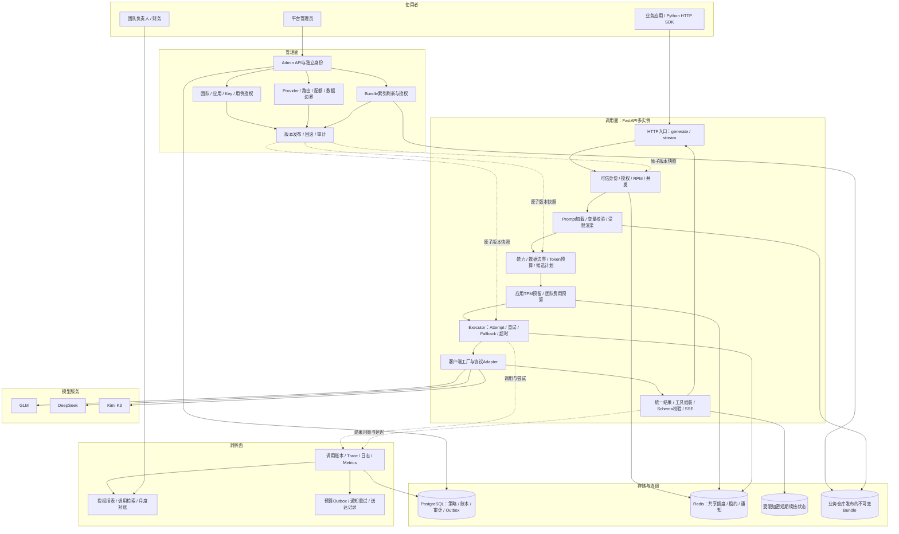
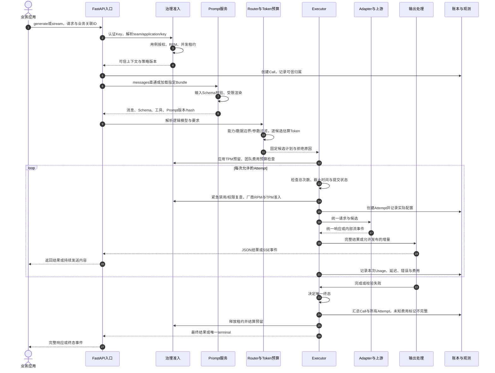
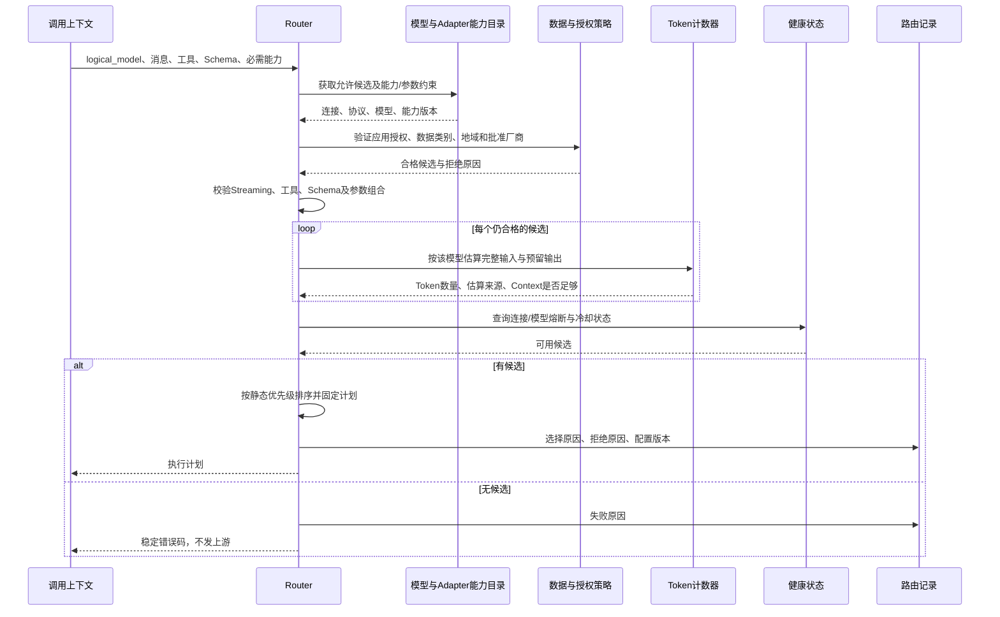
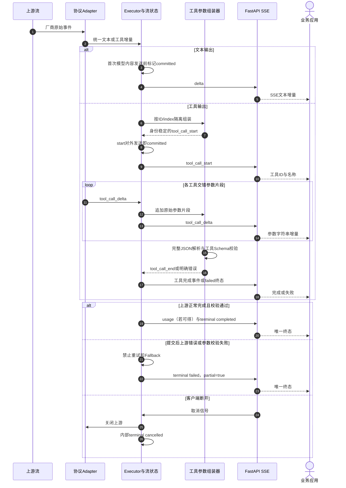
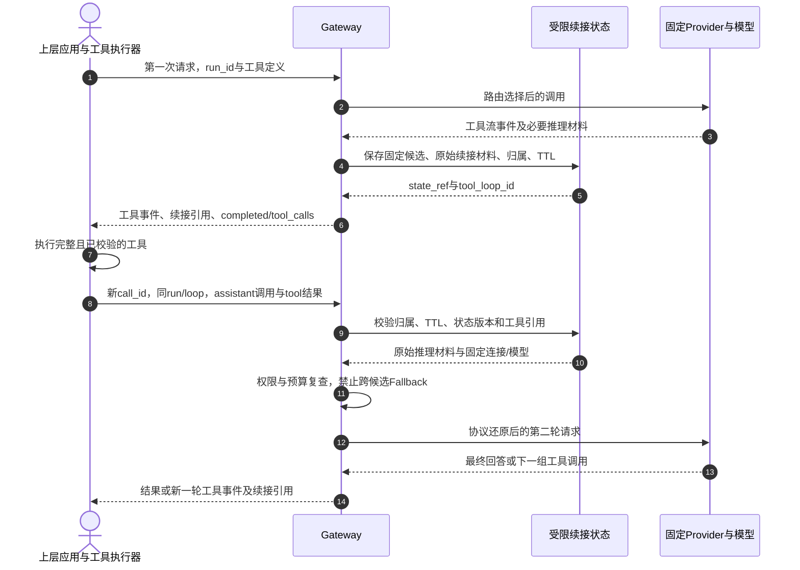
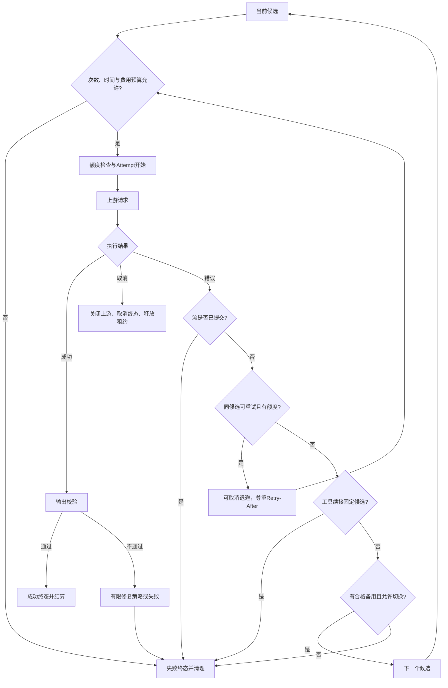
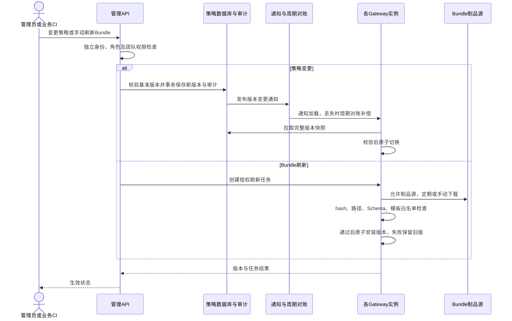
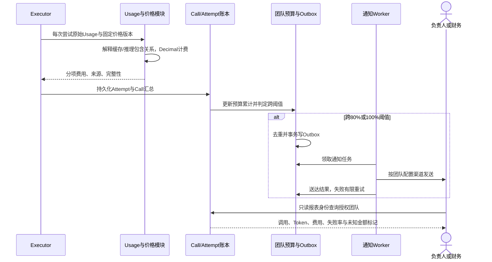
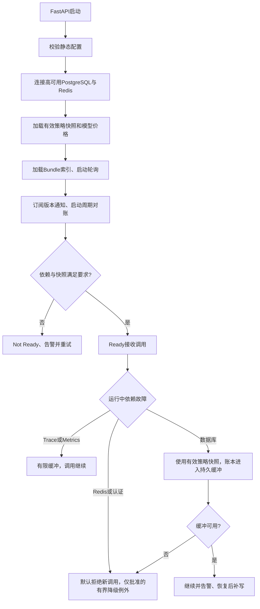

# LLM Gateway 整体架构与流程泳道图

- 日期：2026-10-30
- 基线：技术方案V1.3、实施边界文档
- 范围：V1；文本Streaming、Tool Calling Streaming均为必选
- 图例：实线为调用/数据流，虚线为策略下发或观测。时序图的每一列代表一个职责泳道。

## 1. 整体架构：调用面、管理面、洞察面

**边界：**业务应用执行工具；Gateway不执行工具、不编排Agent。协议Adapter转换请求响应，不私自重试。Executor控制唯一终态。人员报表凭据与应用Key分离。

## 2. 单次调用主泳道图

图中loop只代表预算允许的执行，不表示流提交后还能重试。任何阶段取消、失败均进入统一清理路径；预处理失败不会调用上游。普通调用不会提前向客户端返回未校验结果。

## 3. 能力路由与候选规划泳道图

工具续接请求不重新选择其他连接或模型，只检查固定候选是否仍合法可用。能力未知不视为支持；Fallback不能绕过硬要求。

## 4. Streaming与Tool Calling泳道图

正常完成、错误、取消为互斥分支。真实实现通过终态闩锁保证只产生一个terminal。心跳不提交；工具未完整不能执行。V1不发送业务structured_delta。慢客户端使用有界缓冲，超限取消，不无限积压。

## 5. 工具多轮调用泳道图

同一run可以有多个tool_loop_id，不能单凭run_id固定模型。第二轮允许同候选的提交前网络重试；原连接不可用则明确失败。Gateway不把推理材料解析成业务内容，不泄露至日志。

## 6. 重试、Fallback与取消边界

有限模型修复仅在未提交、明确开启且预算允许时作为新Attempt执行；图中失败出口不代表修复成功也失败。修复详情以技术方案为准。重试关闭SDK内部自动机制，所有真实请求均可入账。

## 7. 管理热更新与Prompt刷新泳道图

新策略/Prompt对新Call生效。在途Call固定版本；紧急连接禁用和Key吊销在后续Attempt前额外检查。V1显式指定Prompt版本，V1.1才增加标签与灰度。

## 8. 账本、成本、报表与预算告警泳道图

账本不依赖Trace采样；应用Key只看本应用，人员角色按团队授权。失败Attempt费用也累计，未知用量不填零。通知实现阶段使用模拟渠道，真实发送需启用对应渠道与授权。

## 9. 启动与依赖故障流程

Redis/PostgreSQL及账本缓冲故障导致的失败计入网关自身失败率。高可用是部署前提，仍需故障演练。所有失败路径都需要清理租约和取消上游，不因观测故障悄悄丢失计费记录。

## 10. 建议阅读顺序

1. 第1图看平台全貌与职责。
2. 第2、3图看一次调用如何准入、选择并执行。
3. 第4、5、6图看Streaming、工具循环与失败边界。
4. 第7、8、9图看无重启运维、费用治理与依赖故障。

以上图用于架构审核；字段和错误码以技术方案为准，不新增实现范围。
