# Python LLM Gateway 技术方案 V1.3（缺口修订审核版）

- 状态：待审核，未开始实现
- 基线：合并产品评审建议；技术文档版本 V1.3 不等于产品交付版本 V1.0
- 明确约束：V1.0 必须支持文本 Streaming 与 Tool Calling Streaming
- 日期：2026-10-29
- HTTP 框架：FastAPI
- 首批供应商：GLM、DeepSeek、Kimi K3

## 1. 定位与范围

定位为公司统一的 LLM 调用平台，由调用面、管理面、洞察面组成。统一 Provider 接入、能力路由、普通调用、文本与 Tool Calling Streaming、完整结构化输出、执行可靠性及调用观测；补齐应用身份、权限、配额、预算、热配置与审计。业务流程、业务规则和工具实际执行由上层应用负责。

统一出口约束：新用例必须经网关，厂商Key仅保存在网关受控密钥设施；例外须走独立审批与审计。

目标用户：业务开发者、平台运维、Prompt作者、团队负责人及财务。首批试点业务和规模仍待确认。V1以结构化抽取与文本/工具流式调用两条纵向链路验收。

参考 CC Switch 的供应商预设、协议类型、模型目录、地域和套餐划分，但不直接使用客户端环境变量或 TOML 作为内部模型。预设不等于厂商能力保证；实现时核对端点、参数、模型能力与价格，并执行契约测试。

参考源码：
- https://github.com/farion1231/cc-switch/blob/main/src/config/claudeProviderPresets.ts
- https://github.com/farion1231/cc-switch/blob/main/src/config/codexProviderPresets.ts

### 核心约束

1. 一次调用固定 Prompt 版本、配置快照和候选计划。
2. 每次真实上游请求单独记录 Attempt。
3. 候选必须满足所有必需能力，不静默删除工具、Schema 或参数。
4. 一条客户端响应流只允许一个 Attempt 贡献模型内容。
5. 流只能有一个终态：completed、failed、cancelled。
6. 所有重试、Fallback 和模型修复共享总尝试、时间和费用预算。
7. 输入输出内容与元数据分开存储；密钥不进入日志。

## 2. 技术选型

| 部分 | 方案 |
|---|---|
| HTTP | FastAPI，异步请求与 SSE |
| 数据校验 | Pydantic v2 |
| 上游连接 | 异步 HTTP 客户端，复用连接池 |
| 模板 | Jinja2 沙箱加语法白名单 |
| Trace | OpenTelemetry |
| 日志 | Python logging + JSON Formatter |
| 调用账本 | PostgreSQL |
| 内容存储 | 可替换存储接口，保存脱敏内容 |
| 配置 | YAML启动引导 + PostgreSQL运行时版本，原子热生效、审计和回滚 |
| 共享协调 | Redis，应用限流、TPM预留、并发租约、跨实例配置通知 |
| Python SDK | 默认通过HTTP访问网关，集中鉴权与治理；内核嵌入暂不作为业务部署方式 |

## 3. 总体流程

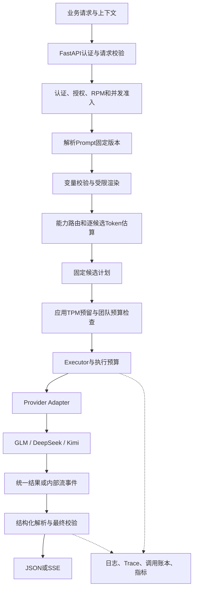

## 4. HTTP 与 Python 接口

| 接口 | 用途 |
|---|---|
| POST /v1/generate | 普通或结构化完整响应 |
| POST /v1/stream | SSE响应 |
| GET /v1/models | 授权范围内逻辑模型及能力 |
| GET /v1/calls/{call_id} | 调用摘要，按团队和应用权限访问 |
| GET /v1/calls | 按business_ref、时间、应用、用例和状态检索，分页 |
| GET /v1/reports/usage | 应用Key仅查询本应用的聚合数据 |
| GET /admin/v1/reports/usage | 人员/BI报表凭据，按角色与团队范围查询 |
| POST /admin/v1/prompts/refresh | 刷新有权管理的Bundle制品，异步任务返回刷新结果 |
| /admin/v1/* | 独立管理认证，管理Key、连接启停、路由、配额和策略版本 |
| GET /health/live | 进程存活 |
| GET /health/ready | 配置和必要依赖就绪 |
| GET /metrics | 内部指标 |

Python 接口：`await gateway.generate(request, context)`；`async for event in gateway.stream(request, context)`。

### 请求参数

```json
{
  "logical_model": "order_extraction",
  "prompt": {
    "name": "extract_order",
    "version": "1.0.0",
    "variables": {"order_text": "订单内容"}
  },
  "generation": {"max_output_tokens": 2000, "temperature": 0},
  "requirements": {"tool_calling": false, "structured_output": "json_schema"},
  "execution": {"total_timeout_s": 60, "max_total_attempts": 4}
}
```

| 参数组 | 字段与规则 |
|---|---|
| 输入 | messages 或 prompt，二选一 |
| 路由 | logical_model、必需能力 |
| 生成 | 输出上限、温度、思考要求、停止条件 |
| 工具 | 定义、版本、选择策略 |
| 输出 | Schema标识、版本、内容或Pydantic类型 |
| 执行 | 总超时、尝试预算、可选费用预算 |
| 扩展 | 按厂商命名空间隔离，显式声明并校验 |

参数默认合并顺序：模型默认 → Prompt默认 → 路由默认 → 授权范围内调用方覆盖；随后执行服务端硬限制校验。越权或超限直接拒绝，不静默夹取。记录请求值、合并后值和实际厂商参数。不支持的显式参数直接拒绝。

CallContext：trace_id、run_id、step_id、request_id、team_id、application_id、api_key_id、auth_policy_version、quota_policy_version、route_policy_version、data_policy_version、user_id、task_type、business_ref、受限metadata。team/application/key及策略版本由网关可信上下文生成，不接受调用方覆盖。tenant_id仅作历史兼容别名，不能作为团队应用报表或授权事实来源。上下文不自动进入Prompt；user_id仅作业务归因。

统一结果：call_id、actual_provider、actual_model、content、tool_calls、structured_data、usage、cost、finish_reason、validation_result。

### 错误与HTTP状态

```json
{"error":{"code":"NO_COMPATIBLE_MODEL","message":"没有满足请求能力的模型","call_id":"call_...","retryable":false,"details":{}}}
```

400 参数组合不支持；401/403 认证权限；422 输入校验；429 Gateway限流；502 上游失败或输出无效；503 无可用候选；504 总超时。

SSE开始前完成认证、输入校验、Prompt渲染和候选检查；开始后的错误通过流事件表达，不能修改HTTP状态。

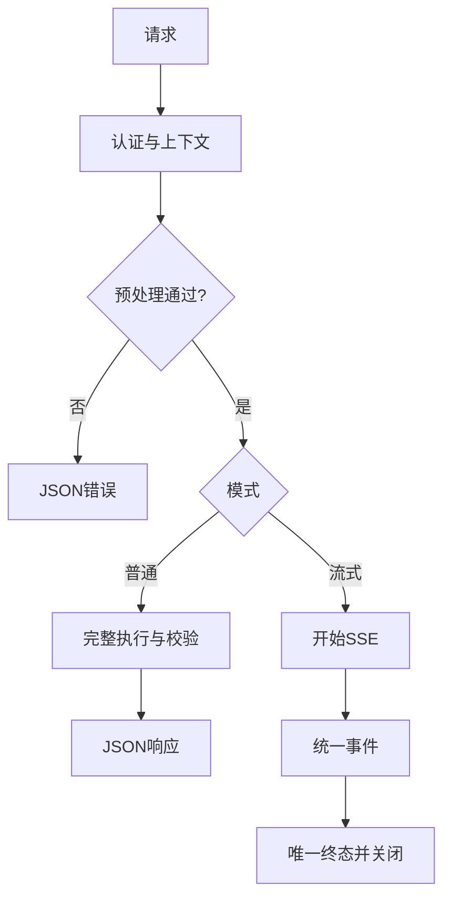

## 5. Provider、模型目录与工厂

| 对象 | 职责 |
|---|---|
| Vendor | 厂商身份 |
| ProviderConnection | 协议、地址、鉴权、地域、套餐、连接参数 |
| ModelSpec | 上游模型名、能力、上下文限制、参数约束、价格引用 |
| RoutePolicy | 候选、能力要求、排序、执行策略 |

一个厂商可以有多个连接，一个连接提供多个模型；厂商身份不等同于协议。

```yaml
providers:
  kimi_cn:
    vendor: moonshot
    protocol: openai_responses
    base_url: "${KIMI_BASE_URL}"
    auth:
      type: bearer
      secret_ref: env:KIMI_API_KEY
    region: cn
    plan: payg
    connection:
      connect_timeout_s: 5
      read_idle_timeout_s: 30
      max_connections: 100
models:
  kimi_k3:
    upstream_model: kimi-k3
    capabilities_ref: kimi_k3_verified
    limits_ref: kimi_k3_limits
    pricing_ref: kimi_k3_price_v1
routes:
  order_extraction:
    candidates:
      - {provider: kimi_cn, model: kimi_k3}
      - {provider: glm_cn, model: glm_default}
    strategy: priority
```

示例不代表已完成能力验证。V1业务流量只配置开放平台按量付费连接；Coding套餐不纳入业务网关默认范围。内部编程工具接入如有需求，另行确认用途和条款。

工厂入参：ProviderConnection与解析后的凭据。创建、缓存、关闭客户端，不负责路由。客户端缓存按连接配置版本、凭据版本失效；模型和生成参数逐次传入，不必每换模型就新建连接池。

Adapter接口：异步generate返回ModelResponse；stream返回AsyncIterator[StreamEvent]。协议层处理Chat、Responses、Messages，厂商覆盖仅处理实际差异。

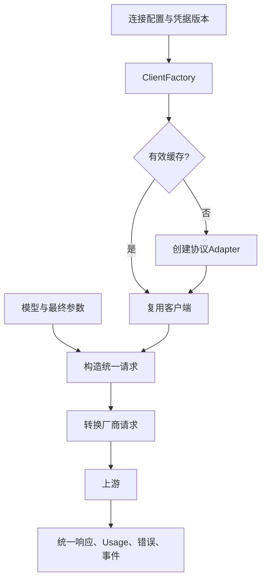

## 6. 能力路由

有效能力由Adapter、端点、模型共同约束。布尔能力取交集，枚举、Schema和参数组合通过约束校验。未知能力不能满足硬要求。

声明：streaming、tool_calling、streaming_tool_calls、parallel_tool_calls、structured_output_modes、input_modalities、reasoning_levels、schema_constraints、parameter_constraints。

本地JSON校验不等于供应商原生Schema约束。原生约束与提示词模拟分别声明，禁止静默降级。

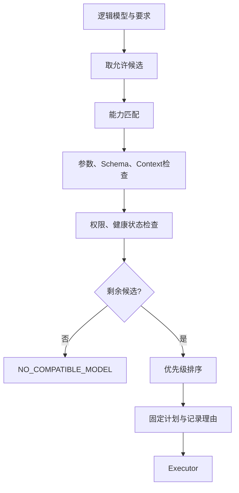

V1按静态优先级与健康状态排序；后续再引入成本延迟策略。自动任务难度分类不属于V1。Fallback候选使用相同硬要求，并按实际模型重新检查Token预算。

## 7. 执行、重试与Fallback

```yaml
retry:
  max_retries_per_candidate: 2
  initial_delay_ms: 500
  max_delay_ms: 5000
  backoff_multiplier: 2
  jitter: true
  respect_retry_after: true
fallback:
  max_switches: 1
budget:
  max_total_attempts: 4
  total_timeout_s: 60
```

max_retries不含首次；总尝试包含首次、重试、Fallback和模型修复。默认值待压测调整。关闭SDK自动重试，避免放大。

| 错误 | 默认处理 |
|---|---|
| 连接失败、临时服务故障 | 重试，耗尽后按策略Fallback |
| 限流 | Retry-After或退避，允许切备用 |
| 鉴权、模型不可用 | 不重试原配置，可跳过候选 |
| 参数错误 | 立即失败 |
| 输出校验失败 | 独立有限修复策略 |
| 流已提交后的失败 | 结束流，禁止重试和Fallback |
| 取消、总预算耗尽 | 取消上游并结束 |

超时分排队、连接、首内容、流空闲和总超时。每个阶段消耗相同总截止时间。等待可取消。超时可能产生重复执行和未知费用，不能假设失败免费。

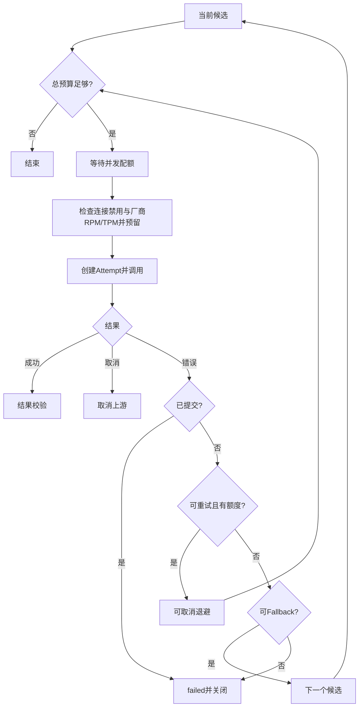

## 8. Streaming与SSE

内部事件：delta、tool_call_start、tool_call_delta、tool_call_end、structured_delta（V2预留，V1不发送）、usage、terminal。携带call_id与递增sequence。Adapter不拼SSE，不直接生成对外终态，由执行器统一决定。

心跳与Gateway请求ID不提交流；首个模型文本、工具参数或结构化内容发出后提交。上游开始事件先缓存。tool_call_start一旦对外发送也构成提交，即使参数尚未输出。提交后禁止重试当前模型或切换模型拼接。工具调用需完整并验证后才能标记可执行。

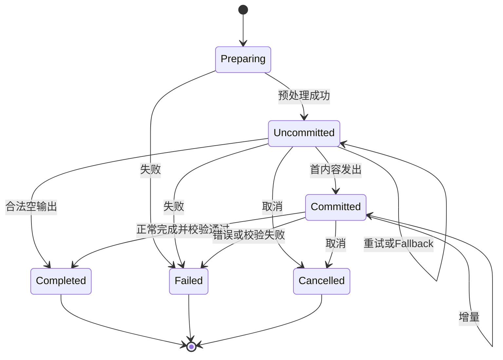

异常断流不能记成功。客户端断开时取消上游，内部记录cancelled，但无法保证终态还能送达。V1不提供断线续传；sequence仅用于排序和排查。慢客户端通过有界缓冲和背压控制内存，超过策略限制取消调用。

```text
id: 12
event: delta
data: {"call_id":"call_...","sequence":12,"text":"订单"}

id: 13
event: terminal
data: {"call_id":"call_...","sequence":13,"status":"completed"}
```

## 9. Structured Output

请求携带JSON Schema，返回后Pydantic严格校验。Python SDK支持Pydantic类型；HTTP使用注册Schema或受限JSON Schema。明确支持子集，不承诺任意JSON Schema都能转换为Pydantic。

V1只支持非流式业务Structured Output：完整响应后解析与严格校验。请求streaming与业务json_schema增量模式组合时返回FEATURE_NOT_SUPPORTED，不能缓冲完整结果后假装增量解析。工具参数流式组装是独立能力，V1必须支持。

修复默认：确定性提取最多一次，仅处理约定包装；模型修复默认关闭，明确开启时最多一次且计入总预算。禁止补造业务字段。工具参数校验失败不自动改写参数。

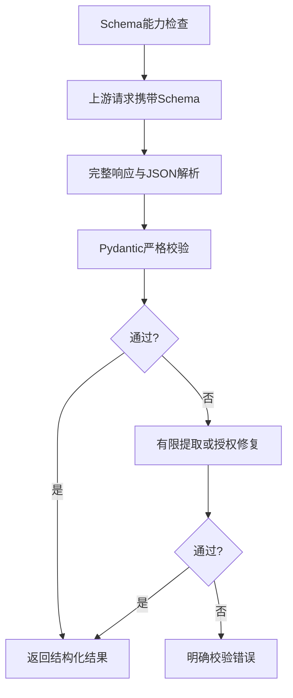

V2按实际需求增加业务JSON增量解析：逐Chunk解析，部分值provisional，最终校验后才成功；流已提交后不修复、不Fallback。

## 10. Prompt Bundle与分期

V1提供最小Bundle加载与安全渲染：业务仓库维护，独立只读发布制品挂载/下载至网关；不要求业务修改网关仓库。直接messages加Schema同样能完成抽取。V1.1建设注册API、CI发布、标签与回滚；production/canary标签在Call开始解析为固定版本，记录版本/hash与标签快照。

每个不可变发布版本包含manifest、System和User模板、输入Schema、输出Schema、Few-shot、工具定义锁定版本、默认逻辑模型及参数、Context预算、Eval集及门槛、变更说明与状态。

渲染前校验变量类型、长度、必填项；缺失或超长直接拒绝。Jinja2沙箱加AST白名单，只允许变量替换和受限条件分支，禁止函数调用、任意属性访问、导入、循环、eval与exec。限制渲染大小。V1超预算明确拒绝，不自动截断。

Bundle hash覆盖全部影响行为的内容；每次记录解析后的名称、版本和hash。记录版本不能保证模型输出完全一致。

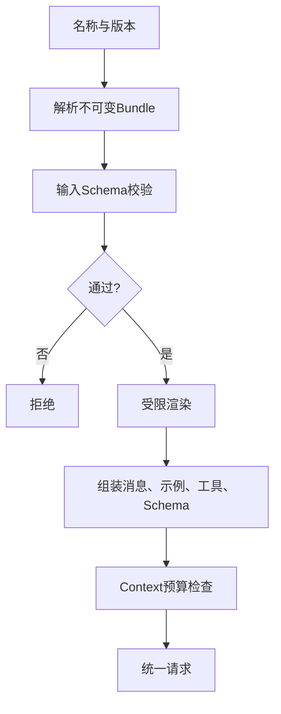

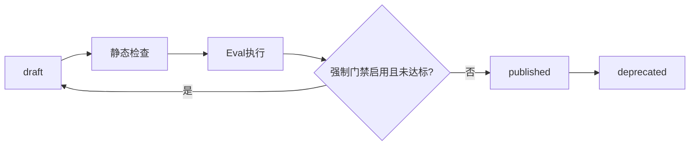

## 11. Token、成本与延迟

### Token

调用前优先用厂商Tokenizer或计数接口，否则使用明确标记的估算。覆盖System、历史消息、Few-shot、工具、Schema和协议开销。

预算：估算输入Token + 预留输出Token + 安全余量 ≤ 模型上下文限制。每个候选独立检查。

调用后优先使用供应商Usage：input_tokens、output_tokens、cached_input_tokens、cache_write_tokens、reasoning_tokens，同时保留raw_usage、usage_source与usage_complete。

缓存可能已包含于input，reasoning可能已包含于output；由厂商Usage适配器解释，禁止直接求和。取消或失败导致缺失时记未知或估算，不记零。

### 成本

使用Decimal与版本化价格。按供应商规则分别计算普通输入、输出、缓存读取、缓存写入与其他项。记录币种、单位、价格版本、来源、完整性。

Call累计所有Attempt，包括失败重试和修复。未知费用标记不完整。预算检查不能保证供应商最终账单绝对不超限。

### 延迟

| 字段 | 口径 |
|---|---|
| queue_ms | Gateway等待执行资源 |
| route_ms | 能力过滤与计划生成 |
| ttft_ms | 上游开始至首文本Token，无文本为空 |
| first_content_ms | 上游开始至首有效内容 |
| generation_ms | 首内容至上游结束 |
| total_ms | Gateway接收到唯一终态 |

Call和Attempt分别记录；总耗时包含Prompt、排队、失败尝试、退避和校验，不简单相加。单调时钟计算耗时，UTC存时间戳。上游排队未知时不得混入Gateway排队。

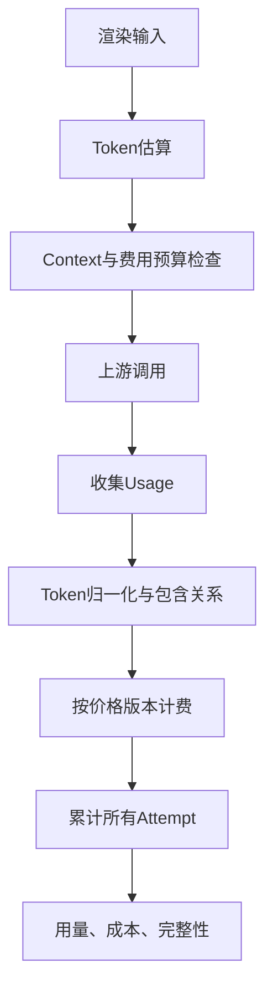

## 12. Trace与调用账本

关联：trace_id → run_id → step_id → call_id → attempt_id。另有span_id与parent_span_id表达技术执行关系，业务Run/Step不能替代Span。

| 维度 | 字段 |
|---|---|
| 关联 | trace、span、run、step、request、call、attempt ID；team_id、application_id、api_key_id |
| 策略 | auth/quota/route/data策略版本、配置快照版本；Call固定版本，Attempt另记实际安全检查版本 |
| 路由 | 逻辑模型、候选、能力要求、拒绝与选择理由、实际供应商及模型 |
| Prompt | 名称、版本、hash、输入输出Schema版本/hash、工具版本 |
| 用量 | input/output/cached/cache-write/reasoning、来源、完整性 |
| 延迟 | queue/route/TTFT/first-content/generation/total |
| 弹性 | attempt/retry/fallback序号、超时阶段、预算配置与消耗 |
| 结果 | 原始及统一finish reason、终态、partial、校验及修复结果 |
| 错误 | 稳定错误码、可重试、上下游HTTP状态、厂商请求ID |
| 成本 | 分项及总额、币种、价格版本、完整性 |

建议表：llm_calls、llm_attempts、llm_route_decisions、llm_call_events、llm_content_refs。调用账本不依赖Trace采样。内容单独脱敏存引用。

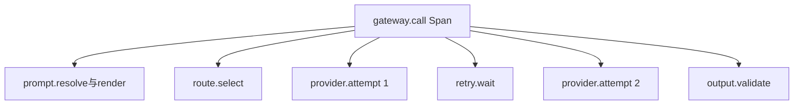

## 13. 日志标准

### 13.1 分工与格式

应用日志用于运行诊断，JSON输出至stdout；调用账本保存完整状态、用量费用；Trace展示执行关系；Metrics聚合趋势。日志不能代替账本。

必需字段：timestamp（UTC RFC3339毫秒）、level、event、message、service、service_version、environment、schema_version。

有上下文时追加trace_id、span_id、request_id、run_id、step_id、call_id、attempt_id、team_id、application_id、api_key_id、task_type、策略版本。缺失字段按约定省略或null，不用空字符串。事件名采用稳定领域命名，不含动态ID。

| 事件 | 级别 |
|---|---|
| gateway.call.started | INFO |
| gateway.route.selected | INFO |
| gateway.attempt.started/completed | INFO |
| gateway.retry.scheduled | WARNING |
| gateway.fallback.selected | WARNING |
| gateway.stream.committed | INFO |
| gateway.output.validation_failed | WARNING |
| gateway.call.completed/cancelled | INFO |
| gateway.call.failed | WARNING或ERROR |
| gateway.recorder.failed | ERROR |

治理、熔断、工具流式、Prompt刷新与通知事件见第28节，属于同一日志标准。

DEBUG用于开发诊断；INFO正常生命周期；WARNING预期内上游失败、重试、限流；ERROR内部缺陷和必要依赖故障。异常栈由负责边界记录一次，上层引用错误码，避免重复堆栈。

```json
{
  "timestamp": "2026-10-29T03:20:15.123Z",
  "schema_version": "1.0",
  "level": "WARNING",
  "event": "gateway.retry.scheduled",
  "message": "上游限流，安排重试",
  "service": "llm-gateway",
  "service_version": "0.1.0",
  "environment": "prod",
  "trace_id": "trace_...",
  "run_id": "run_...",
  "step_id": "step_...",
  "call_id": "call_...",
  "attempt_id": "attempt_...",
  "provider_id": "glm_cn",
  "model_id": "glm_default",
  "attempt_no": 1,
  "retry_no": 1,
  "fallback_no": 0,
  "error_code": "UPSTREAM_RATE_LIMITED",
  "upstream_http_status": 429,
  "provider_request_id": "upstream_...",
  "delay_ms": 1200,
  "remaining_timeout_ms": 42000
}
```

### 13.2 安全与容量

- 禁止密钥、Authorization、Cookie、令牌进入日志。
- 默认不写完整Prompt、变量、输出和工具参数；内容存储单独授权、脱敏。
- 上游错误体和异常文本同样脱敏并限制长度。
- 不逐Token打印；记录开始、提交、异常与终态。
- 单条日志建议上限16KB，截断加标记。
- 部署平台轮转stdout，不让多进程直接写同一日志文件。
- trace_id、call_id、用户ID不作Metrics标签。
- 记录服务故障必须告警；生产使用可恢复队列或持久化缓冲，不能只依赖内存。
- 日志、内容与账本保留期限分别配置，依据实际部署要求确定。

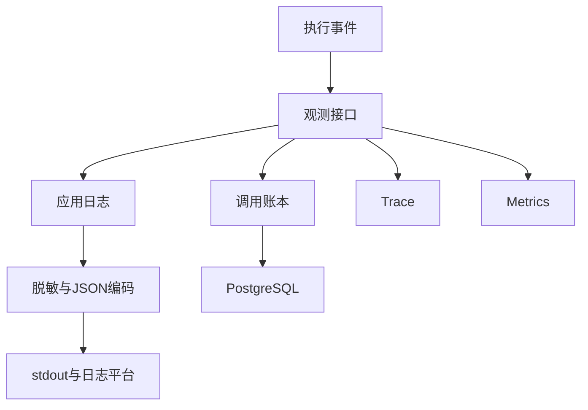

### 13.3 稳定错误码

REQUEST_INVALID、AUTHENTICATION_FAILED、ACCESS_DENIED、PROMPT_NOT_FOUND、PROMPT_VARIABLE_INVALID、CONTEXT_BUDGET_EXCEEDED、NO_COMPATIBLE_MODEL、PARAMETER_UNSUPPORTED、UPSTREAM_AUTH_FAILED、UPSTREAM_RATE_LIMITED、UPSTREAM_TIMEOUT、UPSTREAM_UNAVAILABLE、STREAM_INTERRUPTED、OUTPUT_PARSE_FAILED、OUTPUT_VALIDATION_FAILED、ATTEMPT_BUDGET_EXCEEDED、COST_BUDGET_EXCEEDED、CALL_DEADLINE_EXCEEDED、CALL_CANCELLED、INTERNAL_ERROR。

补充错误码及HTTP映射见第28节：FEATURE_NOT_SUPPORTED、GATEWAY_RATE_LIMITED、TEAM_BUDGET_EXCEEDED、DATA_POLICY_DENIED、DEPENDENCY_UNAVAILABLE、TOOL_ARGUMENT_VALIDATION_FAILED及工具续接错误。

程序判断使用稳定code。供应商原始code另存，不能直接充当统一错误码。

## 14. 生命周期与部署

FastAPI lifespan初始化配置、目录、记录服务、Trace和客户端工厂；关闭时停止新调用，限时等待，在途超时取消，关闭连接池并刷新记录。

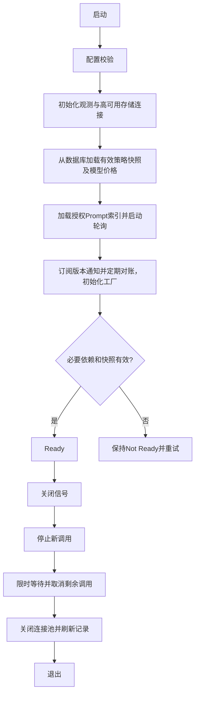

连接池属于每个进程。进程内并发和全局并发分开声明；多实例全局限流和预算采用共享协调设施，不能使用普通进程变量假装全局限制。

## 15. 目录结构

```text
llm-gateway/
├── pyproject.toml
├── src/llm_gateway/
│   ├── app.py                       # FastAPI工厂与lifespan
│   ├── gateway.py                   # 核心入口
│   ├── api/
│   │   ├── dependencies.py
│   │   ├── middleware.py
│   │   ├── error_handlers.py
│   │   ├── sse.py
│   │   ├── admin/                   # 身份、报表、Prompt刷新、策略管理
│   │   └── routes/                  # generate/stream/models/calls/health
│   ├── contracts/                   # requests/responses/events/context/capabilities/errors
│   ├── providers/
│   │   ├── base.py
│   │   ├── factory.py
│   │   ├── registry.py
│   │   ├── protocols/               # openai_chat/openai_responses/anthropic_messages
│   │   └── overrides/               # glm/deepseek/kimi
│   ├── governance/                  # 身份、授权、限流、预算、数据边界
│   ├── control_plane/               # 管理API、版本、热更新、审计
│   ├── resilience/                  # 健康窗口、熔断、探测恢复
│   ├── insights/                    # 查询、报表、账单对账
│   ├── models/                      # 目录、限制、参数约束
│   ├── routing/                     # 匹配、排序、计划
│   ├── execution/
│   │   ├── executor.py
│   │   ├── stream_executor.py
│   │   ├── state.py
│   │   ├── retry.py
│   │   ├── fallback.py
│   │   └── budget.py
│   ├── structured/                  # 增量解析、最终校验、修复
│   ├── prompts/                     # Bundle、渲染、发布检查
│   ├── tokens/                      # 估算与Context预算
│   ├── observability/
│   │   ├── logging.py
│   │   ├── log_schema.py
│   │   ├── tracing.py
│   │   ├── metrics.py
│   │   ├── recorder.py
│   │   ├── usage.py
│   │   ├── pricing.py
│   │   └── redaction.py
│   ├── storage/                     # 持久化与内容存储
│   └── config/                      # 加载、校验、快照、密钥引用
├── config/                          # providers/models/routes/pricing/logging.yaml
├── examples/prompt_bundles/          # 示例；业务Bundle实际在业务仓库维护
│   └── extract_order/1.0.0/
│       ├── manifest.yaml
│       ├── system.jinja2
│       ├── user.jinja2
│       ├── input.schema.json
│       ├── output.schema.json
│       ├── few_shots.json
│       ├── tools.lock.json
│       ├── evals/
│       └── CHANGELOG.md
├── sdk/python/                      # HTTP SDK，含工具多轮消息与continuation支持
├── migrations/
├── tests/
│   ├── unit/
│   ├── adapter_contract/
│   ├── integration/
│   └── fixtures/
└── docs/
    ├── architecture.md
    ├── api-contract.md
    ├── logging-standard.md
    ├── error-codes.md
    └── provider-capabilities.md
```

这是计划目录，当前仅输出方案文档，不创建实现占位文件。

## 16. Tool Calling Streaming详细契约（V1必选）

| 事件 | 核心数据 | 约束 |
|---|---|---|
| delta | text | 文本可与工具事件交错 |
| tool_call_start | tool_call_id、index、name | 首次发送即提交整条流 |
| tool_call_delta | tool_call_id、index、arguments_delta | 原始字符串片段，不保证单片合法JSON |
| tool_call_end | tool_call_id、parsed_arguments、validation_result | 完整解析与参数Schema校验通过后标记可执行 |
| usage | 归一化用量及来源 | 可以缺失；无数据不补零 |
| terminal | status、finish_reason、partial、error | 全Call只出现一次 |

同一流维护按tool_call_id/index隔离的组装器，支持多个工具调用交错输出。厂商ID或名称可能跨片段出现，Adapter需先稳定映射再发start；不暴露后续会改变的工具身份。限制工具数量、单工具参数长度与总缓冲。

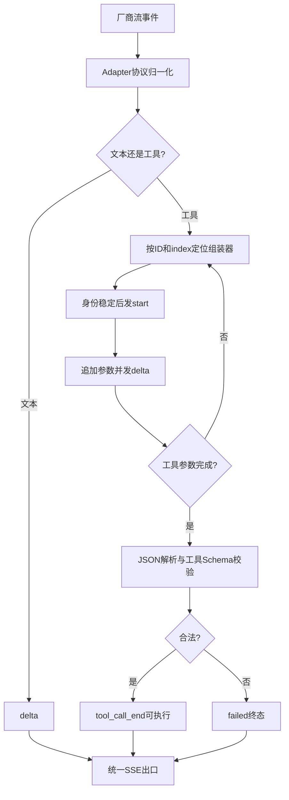

未完成工具在取消/失败时标记incomplete，禁止执行。某工具已完整不意味着其他工具成功；上层工具执行建议等待正常终态，并明确自行承担提前执行的副作用。Gateway不执行工具。模型请求工具属于成功生成，统一finish_reason为tool_calls，流终态仍为completed。

## 17. 治理模型与准入流程（V1）

| 对象 | 规则 |
|---|---|
| Team | 成本与月预算归属单位 |
| Application | 团队下调用身份，持有多个可轮换Key |
| UseCase | 业务用例，接口继续使用logical_model；授权、数据级别、执行策略挂在此处 |
| Policy | 应用RPM/TPM/并发、覆盖参数白名单、团队预算与数据规则 |
| APIKey | 只保存安全摘要，包含key_id、应用、有效期、状态；原文仅签发时返回 |

数据边界用允许地域、批准厂商/部署和数据类别明确表达，不能只用单一数字比较。所有Fallback候选执行相同检查。业务透传user_id只作归因，不作授权依据。

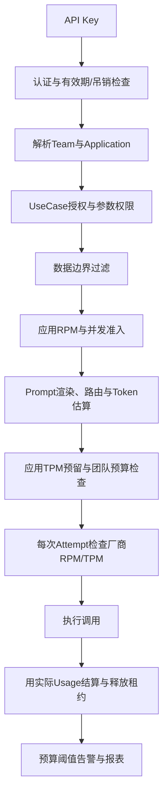

RPM按Call计量，另设Provider Attempt级RPM/TPM限制，避免重试绕开供应商额度。TPM调用前预留估算输入与输出额度，结束后按Usage结算；未知用量保守保留并标记待核算。并发采用有TTL、可续期、带所有权的租约，取消及失败释放，避免进程崩溃永久占用。

资源池主键为application_id + workload_class（online/offline）；UseCase定义允许类别与默认类别，应用策略限制其可用额度，调用方不能自行把离线升级为在线。连接级总额度之下为在线池保留容量，离线池只使用自身额度或明确可借用的剩余容量。在线与离线分别分配资源池及队列上限；V1离线不提供批处理API，但不得允许普通批量调用耗尽在线保留容量。

团队月预算默认80%一次性阈值告警，100%按配置继续告警或拒绝新调用。月份按团队配置时区计算。V1硬预算为可选保守准入，不承诺供应商实际账单绝对封顶；V2完善并发金额预留、结算与硬预算。

Key轮换允许短期重叠，吊销目标一分钟内全实例生效；缓存TTL和版本通知共同保障。超期的认证缓存不得用于持续放行。

## 18. 管理面、热配置与审计

V1管理API使用独立管理员服务凭据和角色，不接受普通应用Key执行管理操作。V1.1接公司SSO。凭据访问与策略管理分权。

管理对象：团队、应用、Key、UseCase授权、Bundle所有权与刷新、连接启停、路由优先级、配额、预算及通知渠道、价格版本。数据库为运行时策略事实来源；YAML只作启动引导，不覆盖已发布策略。

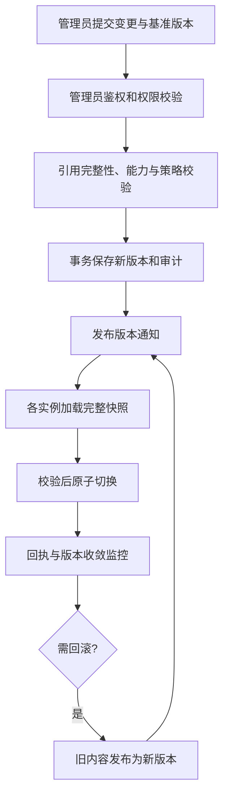

Call固定配置版本；普通变更影响新Call。紧急连接禁用额外在每次新Attempt前检查，禁止旧Call继续新建该连接请求；已有在途请求默认不强断。Key吊销对新请求和后续Attempt检查，在途取消作为独立显式操作。

审计字段：actor、角色、操作、对象、变更前后版本、脱敏diff、原因、时间、request_id/trace_id、结果。密钥原文不进入diff。

## 19. 健康、熔断与依赖故障

按连接及必要的模型维度统计，避免一个模型故障下线整家厂商。鉴权错误可隔离连接；业务参数错误与客户端取消不计供应商健康失败。

建议初始参数：30秒滚动窗口、至少20次样本、可归因故障率50%时打开熔断；冷却30秒后限量探测，连续3次成功关闭，失败重新打开。参数均需按试点压测校准。429优先按Retry-After做冷却，不机械视为全局服务损坏。

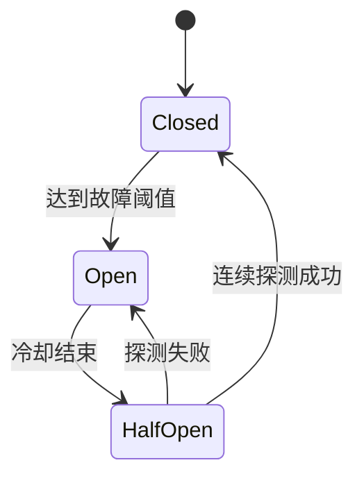

| 依赖故障 | 默认策略 |
|---|---|
| Key无法验证、授权策略无有效快照 | 拒绝，禁止绕过认证 |
| Redis限流/并发不可用 | 默认拒绝新调用；仅明确配置的低风险应用允许有界本地降级并告警 |
| 配置数据库暂不可读 | 使用有效最后快照；暂停管理写操作；新实例无快照不Ready |
| Trace或Metrics不可用 | 调用继续，有限缓冲并告警 |
| 账本暂不可写 | 持久化缓冲；缓冲不可用或耗尽时拒绝新调用；在途尽力完成并告警 |
| 月预算数据过期 | 告警模式明确标记不完整；硬预算模式拒绝新调用 |

## 20. 洞察、检索与质量闭环

V1提供按Team/Application/UseCase/模型/Prompt版本/时间统计调用、失败、Token与费用；按business_ref检索必须同时施加团队与应用授权。账本与查询均分页，避免无界扫描。

费用账本不可随新价格重写；调整与对账以追加调整项保存，记录原因。区分估算、实际供应商用量和外部账单金额，不将折扣、税费、币种差异混为Token差异。

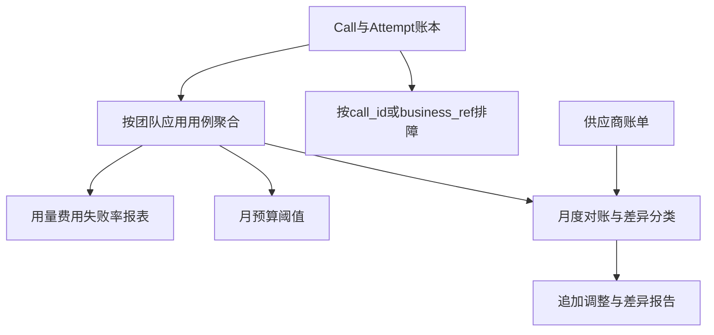

V1.1增加POST /v1/calls/{call_id}/feedback、业务结果反馈、Prompt标签发布和加权灰度。反馈内容受Schema与权限控制，不直接作为可信质量标签。

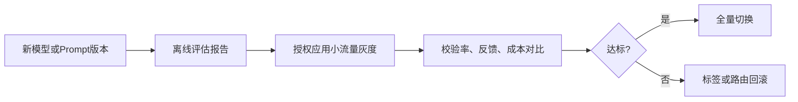

## 21. 数据表与目录补充

在llm_calls、llm_attempts、llm_route_decisions、llm_call_events之外增加teams、applications、api_keys、use_cases、application_grants、policy_versions、provider_versions、pricing_versions、admin_audit_logs、budget_periods、cost_adjustments。

V1只存元数据和内容hash/受限引用，不要求长期保存原始业务内容；工具协议必需的短期加密续接状态按第24节单独管理；V1.1提供脱敏内容留存与授权查看，保留期独立配置。工具参数、Prompt、输出默认不进入日志。

目录增加api/admin/、governance/、control_plane/、resilience/、insights/及SDK HTTP客户端包。Prompt示例可在网关仓库，业务Prompt制品实际由业务仓库独立维护。

## 22. 分期与验收

| 能力 | V1.0 | V1.1 | V2按需 |
|---|---|---|---|
| FastAPI、HTTP/Python SDK、三种协议、三家接入 | 必选 | 扩展 | 扩展 |
| 文本Streaming、Tool Calling Streaming、SSE | 必选 | 完善 | 可评估续传 |
| 工具参数分片组装、完整解析与Schema校验 | 必选 | 完善 | 完善 |
| 非流式Structured Output与Pydantic校验 | 必选 | 完善 | 完善 |
| 业务Structured Streaming增量JSON | 不提供 | 预留 | 有需求再实现 |
| Prompt最小加载、变量校验、版本/hash | 必选 | 完善 | 完善 |
| Prompt注册API、CI、标签、Eval报告 | 最小报告可选 | 必选 | 完善 |
| 应用鉴权授权、配额、数据边界、预算告警 | 必选 | 完善 | 完善硬预算 |
| Admin API热配置、启停、审计、回滚 | 必选 | SSO、加权灰度 | UI与动态策略 |
| Trace、Token/Cost/Latency、账本与报表 | 必选 | 内容与质量反馈 | 优化 |

按场景纵向交付：
1. 结构化抽取：身份授权→messages/最小Bundle→能力路由→完整输出校验→Attempt账本与成本。
2. 工具流式：同一治理入口→工具分片与交错组装→SSE→提交边界、取消与唯一终态。
3. 运维治理：故障注入→熔断/Fallback→热下线→检索→费用报表与预算告警。

V1技术验收：
- 三协议使用契约测试验证请求、完整响应、文本流和工具流；具体候选不支持时明确拒绝。
- 多工具交错、ID/名称跨片段、参数任意Chunk切分均正确；不完整工具不可执行。
- tool_call_start即提交，提交后任何错误不能重试或切换；全流只有一个内部终态。
- 首内容前重试、Fallback、Retry-After、所有取消路径与总预算正确。
- 未授权和数据边界不满足的候选不发上游；Fallback不能绕过。
- 非流式JSON/Pydantic校验失败明确报错；业务Structured Streaming在V1明确拒绝。
- 未知费用不记零；重试修复均入账；日志不泄密；记录依赖故障策略可验证。
- 配置热更新原子、可回滚；Key吊销与紧急禁用在约定时间内生效。

产品验收建议：两个试点稳定运行两周；接入首次成功≤1天；厂商下线≤5分钟；Key吊销≤1分钟；自身失败率≤0.1%；网关附加延迟P95≤50ms。以上为建议目标，需先定义负载、测量边界、样本量及可用备用容量。月度账单差异≤3%是待基线验证目标，不能作为未完成月度周期的即时验收承诺。

## 23. 已确定与待确认

已确定：FastAPI；三协议；GLM/DeepSeek/K3；文本和Tool Calling Streaming属于V1；能力驱动；提交后不重试/Fallback；统一日志和Trace、用量成本。

待审核建议：PostgreSQL与Redis；API Key与管理员身份方案；健康阈值；各路由超时与重试默认；Prompt最小制品加载方式；依赖故障降级白名单；预算硬限制范围。

待业务确认：试点、吞吐和并发、上线时间与人力、数据分级、厂商采购与价格、已有身份设施、日志与账本保留期。没有这些数据不承诺工期。

本文是汇总技术基线。LLM_GATEWAY_PM_PROPOSAL.md保留为产品评审来源，其中“V1流式只输出文本”已被用户后续明确要求覆盖；最终范围以本文第22节为准。


## 24. 工具多轮调用与续接契约（V1）

Gateway只生成工具调用，不执行工具或编排循环。上层收到completed且finish_reason=tool_calls，执行已验证工具，携带工具调用及结果再次调用Gateway。每轮是新的call_id，同一循环使用相同run_id，并使用独立tool_loop_id；一个run可含多个工具循环，不单凭run_id固定模型。

### 统一消息

```json
{
  "messages": [
    {"role":"user","content":[{"type":"text","text":"查询订单"}]},
    {"role":"assistant","content":[],"tool_calls":[
      {"id":"tc_1","name":"lookup_order","arguments":{"order_no":"R123"}}
    ]},
    {"role":"tool","tool_call_id":"tc_1","name":"lookup_order",
     "content":[{"type":"text","text":"订单已发货"}],"is_error":false}
  ],
  "continuation":{"tool_loop_id":"loop_...","state_ref":"opaque_..."}
}
```

工具结果必须引用原始tool_call_id；多工具结果逐项匹配，可按任意顺序回传，但缺失结果不能静默视为成功。工具失败用is_error表达，不伪造正常结果。参数使用已校验对象，必要时保留原始arguments字符串以支持协议准确往返。

| 统一结构 | Chat | Responses | Messages |
|---|---|---|---|
| assistant工具调用 | assistant.tool_calls | function_call输出项 | assistant内容中的tool_use |
| 工具结果 | tool角色与tool_call_id | function_call_output及对应call_id | user内容中的tool_result及tool_use_id |
| 推理续接材料 | 厂商要求的扩展字段 | reasoning输出项/不透明续接材料 | thinking及签名块等 |

映射由Adapter实现并按厂商文档及契约测试验证，不能假设同协议厂商完全一致。内部保留统一消息顺序及原始必要块，禁止转换时静默丢失续接材料。

### 推理材料与固定候选

Gateway将厂商要求的推理块、签名、不透明状态作为provider_continuation原样保留，不解析、修改或混入普通文本，不进入普通日志；可放在受限加密短期状态存储中，向调用方返回state_ref。部署未启用业务内容留存不妨碍该受限协议状态存储；其用途、TTL和权限单独定义。

state_ref绑定team/application、tool_loop_id、首次成功的connection_id、credential身份版本、upstream_model、protocol和状态版本。不可由客户端伪造或跨应用复用。过期返回CONTINUATION_EXPIRED，不降级成新会话。声明需要推理往返的模型，未实现完整保留前不得标记工具循环可用。

第一轮在流提交前可Fallback；最终成功产生工具调用时固定实际连接、协议和模型。后续轮仅允许对同一候选做提交前网络重试，禁止换厂商、连接或模型。原连接故障/禁用、权限变更不再允许时明确失败；重新选择模型必须由上层显式启动新循环。一次性凭据原文不固化在状态中，受控轮换保持账号身份一致。

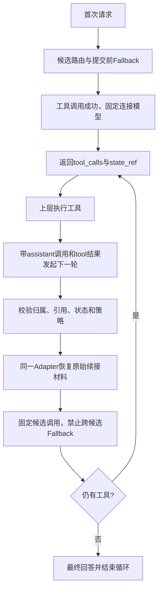

增加max_tool_rounds与tool_loop_deadline，防止上层无界循环；每轮预算独立且受循环总预算限制，取消不撤销已发生的外部工具副作用。

## 25. V1 Prompt刷新与授权

业务Bundle独立发布为不可变、带manifest/hash的制品。网关每60秒（建议值）拉取授权索引，同时提供POST /admin/v1/prompts/refresh手动触发；接口不允许任意URL，制品源在管理员允许列表中。

发布索引包含owner_team_id、允许应用/用例、版本、hash、制品引用；所有权由可信管理配置确定，不能仅信任Bundle自报。新制品下载到临时区，检查大小、路径穿越、hash、Schema和模板白名单，全部通过才原子替换可用索引。失败保留旧版本并记录原因。

V1请求显式版本，新版本可见后新Call即可引用，无需网关重启。V1.1增加production/canary标签；标签原子解析为固定版本，不影响在途调用。新版本可用延迟目标为轮询周期加下载校验时间，手动刷新返回任务状态与各实例版本。启动流程加载初始索引，后台任务持续刷新，不仅启动加载一次。

```mermaid
flowchart LR
 A[业务仓库发布制品] --> B[授权索引]
 B --> C[定时拉取或手动刷新]
 C --> D[下载并验证内容及权限]
 D --> E{通过?}
 E -- 否 --> F[保留旧索引并告警]
 E -- 是 --> G[原子安装新版本]
 G --> H[新Call可使用]
```

## 26. 报表角色与预算告警交付（V1）

管理身份区分platform_admin、team_report_reader、finance_report_reader。V1可签发有有效期的独立只读报表凭据，绑定人员/服务身份与团队范围；不复用应用Key。team_report_reader仅看授权团队聚合和允许的调用元数据；finance_report_reader按明确授权跨团队看费用，不默认获得Prompt、输出、工具参数。报表访问记录审计，凭据可轮换吊销；V1.1迁移SSO。

应用Key访问/v1/reports/usage仅看本应用。人员与BI使用/admin/v1/reports/usage且通过报表角色授权，不要求管理员写权限。可选BI只读视图必须使用受限数据库角色和团队行级隔离，禁止向普通报表用户开放全库。

Team预算策略必须配置owner、收件人组、渠道引用、阈值和通知节流；正式启用预算告警前必须验证至少一个有效渠道。V1支持受控Webhook通知适配器，可接企业群机器人或既有告警平台；邮件如需接入另配适配器。本次仅设计通知机制，不实际发送消息。

告警采用事务Outbox：结算触发阈值事件→持久化通知任务→异步发送→有限重试→失败队列与运维告警。以team+预算周期+阈值+策略版本去重，默认同周期80%和100%各一次；策略修改不能导致无限重复。费用未知、数据延迟单独产生质量告警，避免误称预算充足。

```mermaid
flowchart TD
 A[用量费用结算] --> B[团队预算累计]
 B --> C{跨过阈值?}
 C -- 否 --> D[更新报表]
 C -- 是 --> E[去重并写Outbox]
 E --> F[按团队收件人与渠道发送]
 F --> G{送达?}
 G -- 是 --> H[记录送达状态]
 G -- 否 --> I[有限重试与失败队列]
 I --> J[通知平台运维]
```

## 27. 部署前提与SLO口径

生产部署前提：FastAPI无状态多实例、Redis具备自动故障切换与适当持久化、PostgreSQL高可用及备份恢复、持久化账本缓冲的独立容量与告警。故障切换方案需验证网络分区、连接重建和计数恢复；不能把部署了副本等同于已经验证高可用。

“网关自身失败率≤0.1%”包含Redis、PostgreSQL、鉴权、策略和记录缓冲等网关管理依赖故障导致的失败，不能以依赖故障为由剔除。业务输入错误、客户端主动取消及供应商最终失败单独分桶；同时报告包含上游的端到端成功率。网关附加延迟包含自身排队、渲染、配额、路由、存储必要路径和校验开销，测量条件及输入规模必须注明。

故障演练验收：Redis主节点切换、数据库切换、版本通知丢失、账本缓冲耗尽均能触发既定策略；记录受影响调用数、恢复时间与未知用量。未满足部署前提不能承诺上述SLO。

## 28. 错误码、日志与验收补齐

| 错误码 | 对外HTTP（流开始前） | 含义 |
|---|---|---|
| FEATURE_NOT_SUPPORTED | 400 | 当前版本未支持的功能组合 |
| GATEWAY_RATE_LIMITED | 429 | 应用/网关RPM、TPM或并发限额 |
| TEAM_BUDGET_EXCEEDED | 429 | 团队预算准入拒绝 |
| DATA_POLICY_DENIED | 403 | 无满足数据边界的候选 |
| DEPENDENCY_UNAVAILABLE | 503 | 必要治理或持久化依赖不可用 |
| TOOL_ARGUMENT_VALIDATION_FAILED | 502 | 上游工具参数不合法 |
| TOOL_RESULT_INVALID | 422 | 回传工具结果引用或格式不合法 |
| CONTINUATION_EXPIRED | 409 | 工具续接状态过期 |
| CONTINUATION_MISMATCH | 409 | 模型、循环或协议状态不匹配 |
| TOOL_LOOP_LIMIT_EXCEEDED | 429 | 工具循环轮数/预算超限 |

授权归属错误始终ACCESS_DENIED/403，不能以续接冲突码泄露其他应用状态。SSE开始后上述错误只通过唯一failed终态表达，保留已发HTTP状态。

新增结构化日志事件：gateway.auth.denied、gateway.quota.rejected、gateway.budget.threshold_crossed、gateway.budget.rejected、gateway.circuit.opened/half_opened/closed、gateway.tool.started/completed/validation_failed、gateway.continuation.rejected、gateway.prompt.refresh_completed/failed、gateway.config.activated、gateway.notification.delivered/failed。工具事件不记录参数正文；普通流不逐chunk打印。拒绝与熔断一般WARNING，正常完成INFO，通知或存储内部故障ERROR；同阈值告警聚合节流。

追加V1验收：
- 任一Call/Attempt均有可信team/application/key身份及策略版本，轮换/吊销后历史归属不丢失。
- 三协议至少完成真实或契约模拟的“调用工具→回传结果→模型回答”两轮闭环，覆盖必要推理材料原样往返与多工具。
- 第二轮禁止跨连接/模型Fallback；续接过期、跨应用、引用不完整明确拒绝。
- 新Bundle轮询与手动刷新无重启生效，在途版本不改变，未授权应用不可访问。
- 报表角色范围隔离；80%告警有接收人、送达记录、去重和失败处理。
- 认证/RPM/并发在渲染前，应用TPM在估算后，厂商额度在每次Attempt前检查；失败和取消均释放相应租约。
- Redis/PostgreSQL故障计入网关SLO，演练验证故障切换与恢复。

V1.3变更对应评审五项缺口；V1功能范围继续以第22节和本次明确补充为准，产品评审原文保留。
