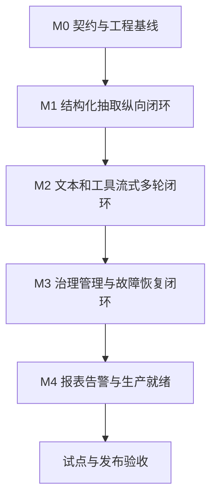

# LLM Gateway V1 实施边界与交付约定

- 日期：2026-10-30
- 基线：已确定的 LLM_GATEWAY_DESIGN.md V1.3
- 用途：约束实施范围、模块责任、阶段出口和变更，避免开发中重新扩大产品范围
- 本次产出：实施边界文档；不代表已开始编码或生产发布

## 1. 执行原则

技术方案已确定，开发不再重开产品定位与技术选型讨论。实现细节在已定约束内自主选择；影响外部契约、功能范围、数据安全或运行语义时记录变更并确认。

V1交付完整纵向链路，而不是只有接口占位或模拟成功。开发环境可以使用模拟上游；三家真实接入的验收必须区分已验证与仅契约模拟，不能混报完成。

开发目录为本项目目录。技术方案作为事实基线，产品评审作为背景；本文件定义执行边界。发生冲突时，用户最新明确决定优先，其次已批准的技术方案；不能由代码实现反向静默修改约定。

## 2. V1必须交付

| 工作包 | 最小完整交付 |
|---|---|
| HTTP与SDK | FastAPI、generate/stream/models/calls/report接口，Python HTTP SDK，错误契约 |
| Provider | GLM、DeepSeek、Kimi K3连接；Chat、Responses、Messages协议Adapter；厂商差异与能力声明 |
| 路由 | 硬能力、参数、上下文、权限与数据边界过滤，固定候选计划与拒绝理由 |
| 可靠执行 | 重试、一次可配置Fallback、总次数/超时预算、取消、熔断、背压 |
| Streaming | 文本及Tool Calling增量、交错工具组装、唯一终态、提交后不切换 |
| 工具多轮 | 统一历史消息、工具结果回传、不透明推理材料续接、固定连接与模型 |
| Structured Output | 非流式Schema请求、完整解析与本地严格校验、有限提取修复 |
| Prompt | 最小Bundle、输入校验、受限渲染、版本/hash、轮询与手动刷新、团队应用授权 |
| 治理 | Team/Application/UseCase、应用Key生命周期、权限、RPM/TPM/并发、数据边界 |
| 管理 | 独立管理身份、策略原子热生效、回滚、紧急连接禁用、审计 |
| 观测 | 可信归属、Call/Attempt账本、Token/Cost/Latency、JSON日志、Trace与Metrics |
| 洞察 | 应用和只读人员报表、business_ref检索、预算告警Outbox、对账调整记录 |
| 运行交付 | 迁移、示例配置、启动方式、测试、故障演练说明、接入和运维文档 |

厂商能力不强行补齐：某模型不支持的能力明确拒绝或排除，但Gateway本身的工具流式能力不可因此删减。三种协议分别验证，不要求每个厂商支持全部协议。

## 3. V1明确不做

- Agent编排、工具真实执行、业务工作流和业务规则。
- 自动分析任务难度、动态成本/延迟优化、影子流量、响应缓存。
- 业务Structured Streaming增量JSON；工具参数流式组装不在此排除范围。
- SSE断线续传、管理UI、模型托管/微调、离线批处理API。
- 完整Prompt注册中心、production/canary标签、加权灰度、SSO、质量反馈闭环；按技术方案留到V1.1。
- 编程工具Coding套餐流量及任意未批准供应商。
- 任意JSON Schema全量支持、输出绝对可复现、精确账单硬封顶等无法保证的承诺。

V1预留接口不等于实现后续版本功能，不提前建设通用插件平台或无实际用途的抽象层。

## 4. 模块责任与禁止越界

| 模块 | 拥有的职责 | 不得承担 |
|---|---|---|
| api | HTTP校验、认证接入、SSE编码与断开 | 厂商协议转换、重试循环 |
| governance | 身份、授权、额度、预算准入 | 生成Prompt或自动修改模型输出 |
| prompts | Bundle校验、固定版本、安全渲染 | 业务流程编排 |
| routing | 候选过滤、排序、执行计划 | 发送上游请求 |
| execution | Attempt生命周期、预算、流状态、重试和Fallback | 工具副作用执行 |
| providers | 请求响应转换、能力与Usage解释 | 私自重试、切换模型、对外SSE终态 |
| structured | JSON解析、约束校验、有限修复 | 补造业务字段 |
| control_plane | 策略版本、发布、回滚、审计 | 绕过数据边界直接改在途输出 |
| observability/storage | 记录、成本、Trace、脱敏、持久化 | 用日志替代账本或泄露密钥 |
| SDK | 请求、事件消费、工具多轮消息辅助 | 保存厂商Key或绕过网关治理 |

依赖方向：HTTP/SDK → 应用服务 → 核心契约及策略 → Adapter/存储接口；核心执行器不能依赖FastAPI Request或Response对象。

## 5. 不可改变的运行语义

1. 每个Call固定Prompt、路由及配置快照；紧急禁用与权限吊销在新Attempt前额外检查并记录实际版本。
2. 每个真实请求只有一个Attempt身份，所有自动重试都可见；关闭底层SDK隐藏重试。
3. 应用RPM/并发在昂贵处理前准入，Token估算后预留应用TPM，每个Attempt前约束厂商额度。
4. 首个文本或tool_call_start等模型事件发出即提交；此后禁止重试或换模型拼接。
5. 一个流只有一个内部终态；断开的客户端不保证收到终态，但账本必须反映取消或失败。
6. 工具参数完整校验前不可执行。Gateway不执行工具。
7. 工具循环首次成功后固定连接、协议及模型；下一轮不能Fallback到另一候选。
8. 不透明推理材料原样保留，受限存储、短期有效，不进入普通日志。
9. 未知Token和费用不能填零；缓存及推理Token不得重复计费。
10. 身份来自可信认证；调用方不能覆盖team/application/key及授权事实。
11. 不支持或越权参数明确报错，不静默降级。
12. 测试环境不发送实际告警；生产渠道启用属于运行部署配置。

## 6. 交付阶段与出口

### M0 契约与工程基线

交付：请求/响应/事件/错误/能力/上下文类型，配置Schema，迁移框架，FastAPI生命周期，SDK骨架与示例上游。

出口：契约测试通过；最小HTTP请求可追踪；明确API字段及公开能力，不以空实现宣称功能完成。

### M1 结构化抽取纵向闭环

交付：可信应用身份→用例授权→messages/最小Bundle→能力路由→单次完整调用→Schema校验→Call/Attempt与Token费用记录；三家及三协议逐步完成适配。

出口：至少一条真实上游抽取链路通过；错误、无效JSON、超限、未授权均可验证；其余厂商验证状态明确列出。该阶段出口不等于V1全部厂商验收。

### M2 文本与Tool Calling Streaming闭环

交付：SSE、交错工具事件、完整参数校验、续接引用与推理材料、两轮工具调用、取消和背压。

出口：三协议契约均覆盖任意切片、多工具交错、异常断流；提交前/后故障边界通过；下一轮固定候选与跨应用续接拒绝通过。

### M3 治理管理与可靠性闭环

交付：完整重试/Fallback/总预算、共享配额租约、熔断恢复、热策略/回滚、Key吊销、Prompt刷新、管理审计与依赖故障策略。

出口：多实例额度一致性、租约泄露恢复、配置通知丢失补偿、热禁用、Key吊销、Bundle无重启刷新和必要依赖故障测试通过。

### M4 洞察与生产就绪

交付：报表角色范围、调用检索、预算Outbox及模拟通知渠道、对账调整、持久化记录缓冲、部署和演练手册。

出口：身份归属完整，费用不重复，通知去重可重试，存储恢复可验证；完成真实供应商能力矩阵和风险清单。

最终验收：全部V1工作包完成，关键契约与故障测试通过。生产SLO需在确定的负载和高可用环境中测量；没有真实Key、试点数据或部署设施时只能报告对应阻塞，不能宣称生产验证完成。

## 7. 实现前必须冻结的契约

- GatewayRequest/Response、StreamEvent、错误码和HTTP映射。
- 统一assistant工具消息与tool结果结构、continuation归属和过期规则。
- Capabilities、参数约束及ProviderConnection/ModelSpec/RoutePolicy配置类型。
- Call/Attempt及事件账本字段、ID生成与策略版本引用。
- Key与管理角色边界、资源池和预算计量口径。

冻结表示保持兼容，并非禁止修正：增加可选字段可在测试覆盖后推进；删除、改含义、改变终态或Fallback规则需要显式变更。

## 8. 测试与完成定义

| 层级 | 必须覆盖 |
|---|---|
| 单元 | 能力过滤、参数合并、价格、Token包含关系、预算、状态机、模板限制 |
| Adapter契约 | 三协议普通/文本流/工具流、Usage、错误、推理续接往返 |
| 集成 | FastAPI+PostgreSQL+Redis，身份、账本、配额、策略热生效与取消 |
| 故障 | 连接/读超时、限流、Retry-After、断流、通知丢失、依赖切换与缓冲耗尽 |
| 安全 | 跨应用/团队访问、续接伪造、模板越界、路径穿越、密钥脱敏 |
| 真实上游 | 三家已配置模型的声明能力、两轮工具调用、用量与计费口径 |

每个工作包完成要求：可运行实现、输入输出示例、相关测试、错误路径、记录字段及必要文档同时齐备。Mock结果与真实上游结果分开标识。测试不修改生产配置、不调用业务工具、不用真实渠道给他人发消息。

## 9. 自主执行与变更边界

可以自主推进：本地代码、测试、迁移脚本、示例配置、开发容器定义、接口文档和可回滚修复；模块内重构与不改变契约的实现取舍。

应提出具体变更后确认：新增V1范围外功能、删减已定能力、外部接口不兼容、增加新厂商/数据出境边界、改变身份与成本策略、改变流提交及工具循环语义。

生产发布、生产迁移、真实付费压测、生产凭据/权限调整、启用向人员发送的通知，需要对应环境与明确授权；先完成本地可评审交付，不以等待部署条件为由阻塞无关开发。

不执行：提交密钥、清空生产数据、自动执行模型生成的工具、无预算的供应商重试、未授权的外部消息。

## 10. 待落实的环境输入

这些事项不重新讨论架构，且不阻塞本地契约与核心实现：

- 三家测试凭据、允许模型、单次和总测试费用预算。
- PostgreSQL/Redis开发环境及生产高可用设施责任人。
- 首批应用、团队、用例和预期吞吐/并发。
- 管理身份、报表人员、预算告警渠道及收件人。
- 内容和续接状态的保留期、加密密钥来源。
- 生产发布方式和具体性能验收负载。

在得到相应信息前使用示例配置、模拟渠道和契约测试；缺失项明确记录，不自行假设生产身份、费用或接收人。

## 11. 下一执行起点

下一步按M0开始工程化，先落地公共契约、配置与账本模型，再纵向打通M1。具体依赖锁定和包版本在编码阶段依据官方兼容信息确定，避免在边界文档中把未经验证的版本写死。
