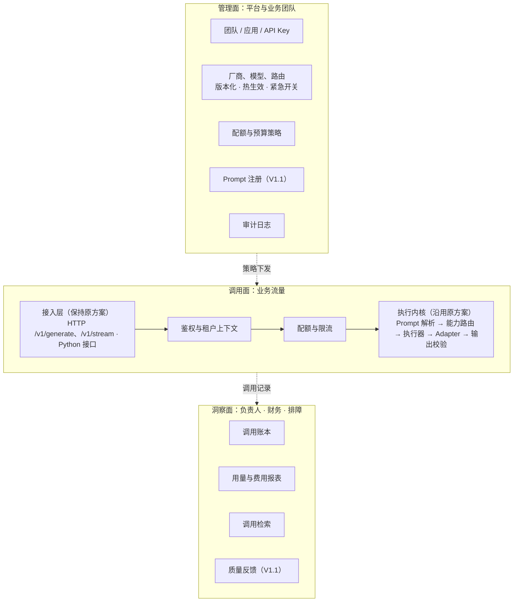

# LLM Gateway 产品评审与方案建议

- 视角：高级产品经理
- 评审对象：`LLM_GATEWAY_DESIGN.md`（V1.1，待审核）
- 日期：2026-10-29
- 状态：建议稿，供评审讨论
- 说明：本文不重写技术细节。原方案的执行内核基本保留，调整的是产品定位、范围、治理能力和交付顺序。标注"建议值"或"假设"的内容需要结合实际业务校准。
- 已确定约束：接入方式和协议适配保持原方案，即第 4 节的 HTTP 接口（`/v1/generate`、`/v1/stream` 等）、Python 接口和请求契约，以及第 5 节的 Chat、Responses、Messages 三种协议适配。本文不对这部分提出调整。

## 0. 结论

原方案是一份扎实的**执行内核**技术设计：调用可复现，流式只有一个终态，重试与 Fallback 共享预算，按 Attempt 记账，日志不泄密。这些约束都应保留。

但从产品角度看，它回答了"一次调用怎样才算做对"，没有回答三个更前置的问题：

1. **为谁解决什么问题，怎样算成功。** 文中没有目标用户、痛点、首批业务和成功指标，V1 的范围因此无从取舍。
2. **谁能用、能用多少、花了多少、出事谁来切。** 鉴权、租户、权限、限流、预算在文中被引用十余处，却没有一节定义。而这恰恰是业务选择"走网关"而不是"直连厂商"的主要理由。
3. **先交付什么。** V1 的功能面已接近成熟的商业网关，又按技术分层排期，文档唯一的业务示例（订单抽取）要到第 4 阶段才能跑通。

建议把定位从"调用执行引擎"调整为"公司统一的 LLM 调用平台"，由执行内核、治理、洞察三部分组成。V1 收窄为"能接、能管、能追溯"，按业务场景纵向交付；Prompt 注册中心、灰度对比、流式结构化解析放到 V1.1 及以后。

另建议把产品需求和技术设计拆成两份文档：本文第 3–5 节可作为产品需求初稿，原方案作为技术设计，各自找对应的人评审。

## 1. 原方案值得保留的设计

| 设计                         | 产品价值                   |
| -------------------------- | ---------------------- |
| 逻辑模型隔离业务与具体模型              | 换厂商、换模型，业务不用改代码        |
| 能力不满足就拒绝，禁止静默降级            | 避免"能跑但质量悄悄变差"这类最难发现的问题 |
| 每次调用固定 Prompt 版本、配置快照和候选计划 | 任何一次结果都能复现、能追责         |
| 按 Attempt 记账，未知费用不记零       | 成本数据可信，失败重试的花费也看得见     |
| 流式提交后不重试、不切换，只有一个终态        | 杜绝两个模型的输出被拼进同一个回答      |
| 稳定错误码和日志安全规范               | 业务能按错误码写处理逻辑，安全审计有依据   |
| 单列待审核决策                    | 评审能聚焦                  |

## 2. 主要问题

### P0-1 缺少"为谁、解决什么、怎样算成功"

第 1 节直接从功能清单开始，缺少：

- **现状和痛点**：现在各业务怎么调模型？主要痛点是 Key 散落在各服务、费用说不清，还是厂商故障时没法切换？
- **目标用户**：业务开发者、Prompt 作者、运维、团队负责人、安全合规，各自要什么？
- **首批业务和量级**：先接谁，每天多少调用，对延迟和可用性有什么要求？
- **成功指标**：上线三个月后，凭什么说这个网关成功了？

后果是评审只能判断"做得对不对"，判断不了"做的是不是最该做的事"。例如文中唯一的业务示例是订单抽取：非流式、结构化输出、能容忍秒级延迟。如果首批业务大多是这类，SSE 背压和流式增量 JSON 解析就不该排在 V1。

### P0-2 平台治理能力缺位（最大缺口）

文中多处依赖这些能力，例如"HTTP 租户和用户来自可信认证信息""调用方授权范围内覆盖""429 Gateway 限流""多实例全局限流和预算采用共享协调设施"，但下面这些问题都没有答案：

- **调用方怎么认证**：网关签发的 API Key、公司 SSO/JWT，还是服务间 mTLS？
- **租户是什么粒度**：团队、应用还是项目？成本归给谁？
- **权限管什么**：哪个应用能调哪些逻辑模型和 Prompt，能覆盖哪些参数？
- **配额和资源隔离**：流量集中到网关后，厂商账号的 RPM/TPM 上限就成了全公司共享的资源。不按应用划分额度、不区分在线和离线优先级，一个批处理任务就能把所有在线业务挤进限流。
- **预算**：目前只有单次调用的可选费用上限，没有团队或月度预算、告警阈值和超额策略。
- **Key 生命周期**：签发、轮换、吊销，泄露后怎么应急。
- **管理操作审计**：谁改了路由、谁发布了 Prompt、谁调了配额。

"谁能用、能用多少、花了多少、谁买单"是业务方和管理层最先问的问题，也是平台相对直连厂商最核心的价值。这部分不定义，网关只是一个更复杂的 SDK。

### P0-3 V1 范围过大，且按技术分层排期

除了已确定的接入方式和三种协议适配，原 V1 还包含能力约束路由、重试/Fallback/预算、SSE 取消与背压、流式增量结构化解析、带 Eval 门禁的 Prompt 发布体系、Token 估算、版本化计价、OpenTelemetry、五张账本表和脱敏内容存储。

第 16 节的五个阶段按技术层排序。文档自己的示例请求（`order_extraction` + `extract_order` + `json_schema`）依赖 Structured Output 和 Prompt Bundle，这两项都在第 4 阶段。

平台产品最大的风险往往不是功能不全，而是交付太慢：业务等不及就会自己直连厂商，之后再迁回网关，成本更高。

### P1-1 Prompt 发布和网关发版耦合

- 规划目录把 `prompt_bundles/` 放在网关仓库里。任何业务改 Prompt，都要给网关仓库提 PR、跟着网关发版。网关团队会成为所有业务迭代 Prompt 的瓶颈，网关的发版风险也会随接入业务数增长。
- 调用方在请求里写死 `"version": "1.0.0"`，每次发布 Prompt 新版本，业务都要改代码、发版；回滚也一样。中心化管理 Prompt 的意义就没了。
- 每次发布都强制过 Eval 门禁。团队还没积累评估集的时候，这会变成接入门槛。

### P1-2 运维和应急能力未定义

- 文中提到"版本化快照"和"按连接配置版本失效客户端缓存"，说明设想了运行时修改配置，但没有定义修改入口：谁改、怎么改、要不要发版、怎么回滚。
- 厂商故障时最需要的紧急开关（一键下线某厂商、调整优先级）没有设计。
- "健康状态"参与路由排序，但没定义怎么判定：被动统计错误率还是主动探测，熔断和恢复的阈值是多少。这直接决定 Fallback 是否真的有效。
- 原方案考虑了记录服务故障，但没有决定鉴权、配额依赖（比如共享计数用的 Redis）故障时是放行还是拒绝。

### P1-3 缺少"模型升级"这一高频流程

首批三家厂商都在频繁发布新模型。"新模型上线 → 离线评估 → 小流量灰度 → 对比 → 全量 → 必要时回滚"会是网关团队每个季度都要走的流程。原方案零件齐全（逻辑模型、Prompt 版本、Eval、账本），但没有把它们串起来：路由只有静态优先级，不支持按比例分流、按应用灰度或影子流量。

### P2-1 数据合规边界

- 日志和内容存储的脱敏设计很完善，但"什么数据能发给哪家厂商"没有定义。订单这类业务输入可能包含个人信息。
- 文中提到 GLM 和 Kimi 的 Coding 套餐连接。Coding 套餐一般面向编程工具，用来跑业务后端流量可能不符合服务条款，需要采购或法务确认。如果网关也打算服务内部开发者的编程工具（Claude Code、Codex 等），那是另一类用户、另一套需求，建议单独评估。

### P2-2 质量闭环只到发布前

Eval 只在 Prompt 发布前运行。上线后效果如何、新旧模型哪个好，都没有数据来源，模型升级和 Prompt 迭代缺少决策依据。

### P2-3 洞察能力只服务工程师

日志、Trace、Metrics 和账本都是为排障设计的。团队负责人和财务需要的是按团队、应用、用例统计的用量和费用、预算消耗、错误率趋势；排障时还需要按 `business_ref` 找到调用。目前只有 `GET /v1/calls/{call_id}`。

### P2-4 非功能需求没有量化

没有吞吐和并发规模、网关附加延迟和可用性目标。另外，默认 60 秒的总超时对推理模型的长输出可能偏短，建议按路由设置默认值。

### P2-5 自研还是选型，没有论证

开源网关普遍已经覆盖"多厂商适配 + Key 与额度管理 + 重试/Fallback + 用量统计"这一层（具体能力以评估为准）。原方案真正的差异化在于：能力约束路由和不静默降级、严格的结构化输出、Prompt 发布治理、Attempt 级账本、严格的流式语义。

建议花一周做对比评估，再决定是全部自研，还是复用开源组件实现原方案的协议适配层（三种协议保持不变），自研执行器、账本和 Prompt 治理。复用时应以库的方式引入，不要在下面再叠一层代理，否则重试发生在代理内部，Attempt 级账本就看不到真实的上游请求。

## 3. 建议方案

### 3.1 产品定位

> 公司内所有 LLM 调用的统一出口：业务团队低成本接入多家模型，平台保证调用可用、可控、可追溯，管理者看得清用量和成本。

原方案是执行引擎；建议方案是执行内核加治理和洞察。接入方式（第 4 节）和执行内核（第 5–9、11–14 节）沿用原方案；第 10 节保留不可变版本、hash 和受限渲染，存放和发布方式按 3.8 调整。

### 3.2 目标用户

| 角色               | 核心诉求                  | 原方案覆盖                   |
| ---------------- | --------------------- | ----------------------- |
| 业务开发者            | 接入简单、稳定、出错好查          | 部分：接口契约完整，缺按业务标识检索调用的能力 |
| Prompt 作者（算法或产品） | 改 Prompt 不等发版，可评估、可回滚 | 部分：发布和网关仓库耦合            |
| 平台运维             | 厂商故障能快速切换，调整不用发版，有告警  | 弱：没有紧急开关，健康判定未定义        |
| 团队负责人、财务         | 按团队看用量和费用，能控制预算       | 弱：只有单次调用成本              |
| 安全合规             | Key 集中、数据不乱发、操作可审计    | 部分：日志安全完善，缺数据边界和审计      |

### 3.3 核心场景

| #  | 场景        | 验收描述                                                     | 阶段   |
| -- | --------- | -------------------------------------------------------- | ---- |
| S1 | 新业务接入     | 拿到 API Key，按接入文档调用 `/v1/generate`，当天完成首次调用               | V1   |
| S2 | 结构化抽取     | 调用 `order_extraction`，得到通过 Schema 校验的结果；失败时拿到明确的错误码      | V1   |
| S3 | 厂商故障      | 主厂商限流或故障时自动切到备选；运维不发版，5 分钟内能手动下线厂商                       | V1   |
| S4 | 成本治理      | 团队负责人每周能看到各用例的调用量、费用、失败率；月预算用到 80% 时收到告警                 | V1   |
| S5 | 排障        | 凭 `call_id` 或 `business_ref` 查到 Prompt 版本、实际模型、每次尝试及失败原因 | V1   |
| S6 | Prompt 迭代 | 发布新版本 → 看 Eval 报告 → 小流量试用 → 切为正式；1 分钟内能回滚                | V1.1 |
| S7 | 模型升级      | 新模型按比例灰度，对比校验通过率、业务反馈和成本后全量                              | V1.1 |

### 3.4 目标、非目标、反目标

**V1 目标**：统一出口，集中管理 Key；调用方鉴权、授权、配额和预算告警；可靠调用（重试、Fallback、总预算）；结构化输出；调用账本和费用报表；不用发版的应急开关。

**V1 不做**：模型托管和微调；Agent 编排和工具执行（沿用原方案的边界）；自动难度路由；响应缓存；SSE 断线续传；Prompt 可视化编辑；管理后台 UI（先提供 Admin API）。

**反目标**（功能都做到了，出现以下情况也算失败）：

- 网关成为业务发版或 Prompt 迭代的瓶颈；
- 网关自己成为主要故障源；
- 费用报表和厂商账单对不上，没人信；
- 为了"调用成功"悄悄降级，业务质量下降却没人察觉。

### 3.5 成功指标（建议值，上线三个月后衡量）

| 维度 | 指标                          | 建议目标         |
| -- | --------------------------- | ------------ |
| 采用 | 新增 LLM 用例经网关的比例 / 存量调用迁移比例  | 100% / ≥ 50% |
| 接入 | 从拿到 Key 到首次成功调用             | ≤ 1 天        |
| 可靠 | 网关自身原因导致的失败率（不含参数错误和上游最终失败） | ≤ 0.1%       |
| 可靠 | 单厂商故障期间，有备选的用例调用成功率         | ≥ 99%        |
| 性能 | 网关附加延迟 P95（不含上游耗时）          | ≤ 50 ms      |
| 成本 | 费用归属到团队和用例的覆盖率 / 与厂商账单的月度差异 | 100% / ≤ 3%  |
| 运维 | 不发版完成厂商下线或切换                | ≤ 5 分钟       |

### 3.6 产品架构：三个面

- **调用面**：接入层保持原方案，HTTP 接口、Python 接口和请求契约都不变。新增的是接入层之后的鉴权、租户上下文和配额限流，把原方案引用了但没有定义的能力补齐。
- **管理面**：原方案没有这一部分。启动期的静态配置继续用 YAML；运行时会变的策略（路由优先级、厂商启停、配额、预算）放到管理面，带版本、审计和一键回滚。V1 只提供 Admin API。
- **洞察面**：在原方案的账本上提供报表和检索。V1 可以直接用 Grafana、Metabase 之类的工具连 PostgreSQL 视图，不必自己做页面。

### 3.7 治理模型（新增）

| 对象 | 说明                                               |
| -- | ------------------------------------------------ |
| 团队 | 成本归属和预算单位，拥有用例和 Prompt                           |
| 应用 | 调用方身份单位，属于一个团队，持有一个或多个 API Key                   |
| 用例 | 即原方案的逻辑模型（如 `order_extraction`），属于一个团队，授权给若干应用调用 |
| 策略 | 应用级 RPM/TPM/并发上限、团队月度预算、可覆盖参数白名单、数据级别            |

建议规则：

1. **鉴权**：V1 使用网关签发的 API Key，只存哈希，可轮换、可吊销，带固定前缀方便泄露扫描。公司如果已有服务身份体系（内部 JWT、服务网格 mTLS），优先复用。
2. **授权**：应用只能调用被授权的用例，`GET /v1/models` 只返回授权范围内的用例。
3. **资源隔离**：厂商账号的额度按应用分配，区分在线和离线优先级，离线批量任务不能挤占在线业务。
4. **预算**：团队月度预算用到 80% 时告警，用到 100% 时按团队选择的策略处理（只告警，或拒绝新调用）。V1 先做告警，硬限额作为可选。
5. **数据边界**：用例标注数据级别，厂商连接标注可承载的级别，路由时作为硬约束，和能力约束走同一套机制。Fallback 也不能落到未批准的厂商。
6. **终端用户**：业务透传的 `user_id` 只用于归因和滥用排查，不参与鉴权。
7. **审计**：发 Key、改路由、改配额、发布 Prompt 等管理操作，记录操作人、时间和变更前后的差异。

### 3.8 对原方案的关键调整

| 主题        | 原方案                                                | 建议                                            | 理由                                        |
| --------- | -------------------------------------------------- | --------------------------------------------- | ----------------------------------------- |
| 定位        | 调用执行引擎                                             | 执行内核 + 治理 + 洞察                                | 治理和洞察是业务走网关的主要理由                          |
| 接入方式与协议适配 | HTTP 与 Python 接口、请求契约；Chat、Responses、Messages 三种协议 | 保持不变                                          | 已确定的约束                                    |
| 命名        | `logical_model`                                    | 接口字段不变，产品沟通中称为"用例"                            | `order_extraction` 是业务用途，不是模型；权限和预算都挂在它上面 |
| 鉴权与租户     | 多处引用，没有定义                                          | 团队 / 应用 / 用例模型，加 API Key、配额、预算、审计（见 3.7）      | 平台治理的基础                                   |
| Prompt 存放 | 网关仓库的 `prompt_bundles/`                            | 业务仓库维护，CI 调用发布 API 注册                         | 网关不成为业务迭代瓶颈                               |
| Prompt 引用 | 请求里写死版本号                                           | 支持 `production`、`canary` 等标签，调用开始时解析为固定版本并记录  | 发布和回滚不用业务发版；与"每次调用固定版本"不冲突                |
| Eval      | 每次发布强制门禁                                           | V1 提供报告，核心用例可开启强制                             | 评估集不成为接入门槛                                |
| 路由        | 静态优先级 + 健康状态                                       | 增加按比例加权；定义健康判定、熔断和恢复                          | 支撑灰度和故障切换                                 |
| 配置        | YAML + 启动校验                                        | 静态配置用 YAML；运行时策略走管理面，版本化、热生效、可回滚              | 应急不用发版                                    |
| 流式结构化输出   | V1 做增量解析                                           | 后移，有真实界面需求再做                                  | 复杂度高，首批场景未必需要                             |
| 成本        | 单次调用的成本和可选上限                                       | 增加团队月度预算、告警、报表和月度对账                           | 管理者的核心诉求                                  |
| 质量        | 发布前 Eval                                           | 增加 `POST /v1/calls/{call_id}/feedback`，回写业务结果 | 模型升级和 Prompt 迭代的依据                        |
| 依赖故障      | 只定义了记录服务故障                                         | 补充鉴权、配额依赖故障时的放行或拒绝策略                          | 事先定好，避免故障时临场拍板                            |

### 3.9 分期路线图（按业务价值纵切）

**阶段 0：决策准备（1–2 周）**

- 确认首批两个试点业务（建议一个结构化抽取类，如有需要再加一个流式对话类），以及它们的调用量和 SLA。
- 完成自研和开源复用的对比评估。
- 核实厂商条款（包括 Coding 套餐的用途限制）和数据合规分级。
- 退出标准：第 5 节的待确认问题都有答案。

**V1.0：能接、能管、能追溯（粗估 6–8 周，假设 2–3 名后端工程师）**

- 接入：按原方案提供 `/v1/generate`、`/v1/stream` 和 Python 接口（V1 流式只输出文本，流式结构化解析后移）；接入文档和示例代码。
- 治理：应用 API Key、用例授权、应用级限流、团队预算告警、管理操作审计。
- 执行内核：按原方案的三种协议适配接入三家；静态优先级加健康熔断；重试、一次 Fallback、总预算；流式提交语义和唯一终态（沿用原方案）。
- 运维：Admin API 热生效（厂商启停、路由优先级、配额）；关键告警。
- 洞察：Call/Attempt 账本；按团队、应用、用例的用量和费用报表；按 `call_id`、`business_ref` 查询。
- 退出标准：两个试点业务的生产流量稳定运行两周。

**V1.1：能迭代**

- Prompt 注册：CI 发布 API、不可变版本、标签和快速回滚、Eval 报告。
- 按比例灰度路由；按模型和 Prompt 版本的对比报表。
- 质量反馈接口。
- 脱敏内容存储和授权查看，用于排障和评估。
- 管理面接入公司 SSO 登录。

**V2：能优化（由需求驱动）**

- 成本或延迟感知路由、影子流量。
- 确定性任务的精确匹配缓存；利用厂商上下文缓存降低成本。
- 流式结构化输出的增量解析。
- 管理后台 UI、预算硬限额、SSE 断线续传、离线批量调用。

### 3.10 V1 验收（产品口径）

原方案第 16 节的技术必过项全部保留，另外增加：

- 两个试点业务在生产环境稳定运行两周，达到 3.5 的可靠性和性能指标。
- 手动下线任一厂商后，有备选的用例调用成功率不低于 99%，全程不用发版。
- 团队费用报表和厂商账单的月度差异不超过 3%。
- 吊销的 Key 在 1 分钟内失效。
- 未授权的调用全部被拒绝，返回 `ACCESS_DENIED`。

## 4. 风险与应对

| 风险          | 影响                  | 应对                               |
| ----------- | ------------------- | -------------------------------- |
| 交付周期过长      | 业务等不及，自行直连，之后迁回成本更高 | 收窄 V1，试点业务的主路径先上线，评估复用开源组件实现适配层  |
| 网关成为单点      | 网关故障等于全公司 LLM 能力不可用 | 无状态多实例；非核心依赖故障时降级，不整体拒绝          |
| 业务绕过网关      | 治理和成本统计失效           | 厂商 Key 只放在网关；直连需要安全审批            |
| 厂商能力和价格频繁变化 | 路由判断和计费失真           | 沿用原方案的能力和价格版本化；定期跑契约测试；价格变更走流程   |
| 费用数据不被信任    | 报表没人看，预算形同虚设        | 每月和厂商账单对账，公开差异                   |
| Coding 套餐条款 | 合规风险，账号可能被封         | 业务流量只走开放平台按量付费连接；确认前不接 Coding 连接 |

## 5. 待确认问题（按影响排序）

1. 首批要接入哪些业务？分别是结构化抽取、流式对话，还是带工具调用的 Agent？调用量多大？——决定 V1 范围。
2. 网关是否也要服务内部开发者的编程工具（走 Coding 套餐）？——决定是否保留 Coding 连接，以及是否拆成两个产品。
3. 团队有几个人，期望什么时候上线？——决定全部自研还是复用开源组件实现适配层。
4. 原方案的 Python 接口在业务侧以什么形态使用：HTTP 客户端，还是把网关内核嵌进业务进程？——如果是后者，需要说明厂商 Key、配额和预算怎样集中管理。
5. Prompt 由谁写、谁维护：业务开发、算法还是产品？——决定 Prompt 注册的形态和优先级。
6. 成本管控要做到什么程度：只看报表，还是要按团队硬限额、做内部结算？
7. 哪些数据不能发给外部厂商？是否需要私有化部署的模型作为候选？
8. 公司是否已有可复用的身份体系（内部 JWT、服务网格 mTLS、统一 SSO）？
