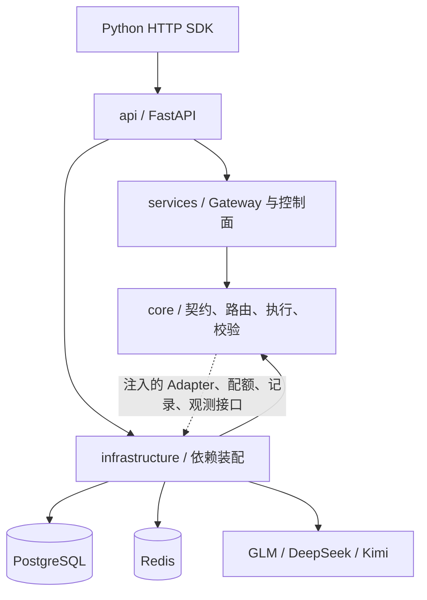

# 分项目架构与责任

本文件落实用户确认的 `src/core`、`src/services`、`src/api` 等独立项目结构；外部 HTTP 契约和 V1.3 功能边界沿用原方案。项目是同一部署单元中的 Python 包，不额外引入跨服务网络调用。

| 项目 | 职责 | 禁止依赖 |
|---|---|---|
| core | Pydantic 公共契约、策略模型、纯授权规则、能力/参数路由、Attempt 状态机、JSON/工具校验、Decimal 计价 | FastAPI、HTTPX、Redis、SQLAlchemy、其他服务端项目 |
| services | 请求准备、准入顺序、Prompt 安全加载与刷新、固定快照、调用收尾、策略版本生效 | API 与具体基础设施实现 |
| infrastructure | HTTP 连接池与三协议转换、PG 账本、Redis 原子配额与熔断、加密续接、持久缓冲、观测、Outbox | API 与 services |
| api | HTTP DTO、Bearer 接入、错误映射、SSE、管理及报表端点、生命周期和依赖装配 | 不承担厂商请求转换或重试循环 |
| sdk | HTTP 请求、事件消费、Pydantic 输出、工具消息辅助 | services、infrastructure、供应商凭据 |

执行器通过实际注入的依赖工作，核心层没有 FastAPI Request/Response。`core` 中的对象可在测试中独立使用；SDK 只共享公共契约，不嵌入调用内核。`tests/unit/test_project_boundaries.py` 通过 AST 检查跨项目导入方向，每个子项目可以独立构建 wheel。

## 运行数据

PostgreSQL 保存完整版本化策略、Call/Attempt、候选拒绝理由、唯一终态、审计、月预算、Outbox 和追加对账调整。团队、应用、Key、用例授权及价格作为原子策略快照保存，避免分表更新导致半套配置生效。Key 只保存摘要，秘密通过 `env:` 引用解析。

Redis 保存共享 RPM/TPM、带期限的并发租约、在线/批量保留容量、按连接和模型的熔断状态、配置通知、加密续接引用与循环计数。供应商额度按 vendor + credential_identity 共享，同账号的不同协议连接不能各领一套额度；这些连接必须配置一致的账号限额。配额使用 Redis 服务端时间及 Lua 原子操作；单账户相关 Key 使用同一哈希标签。部署 Redis Cluster 时还需按实际客户端与拓扑完成兼容验收，本地验证使用单节点 Redis。

每个实例先将账本操作写入自身 SQLite WAL 持久缓冲，再按序幂等写入 PostgreSQL。SQLite 仅承担可恢复缓冲，不承担共享身份、配额或报表。实例需要独立且可恢复的缓冲卷；在途写入保留尽力收尾空间，容量达到阈值即拒绝新调用。

业务输入输出不持久保存全文；账本记录 hash 和元数据。协议必需的短期推理块保存在 Fernet 加密的续接状态中，默认 TTL 900 秒。续接加密密钥必须跨副本一致；轮换需等待旧状态过期或提供受控解密过渡。

## 关键执行语义

新调用固定配置、Prompt hash、参数合并结果和候选计划。新 Attempt 额外刷新安全事实，重查授权、Key 和紧急连接开关。普通策略变化影响新 Call。

应用 RPM/并发先于渲染；完整输入估算后预留应用 TPM；每次 Attempt 再预留累计应用消耗及供应商额度。未知费用和用量保留未知标记；失败或取消不会被视为免费。

文本或 `tool_call_start` 发出即提交，之后禁止重试和切换。工具身份在稳定前缓冲，参数按 index 隔离拼装，完整严格校验通过才发送可执行的 end。网关不执行工具。成功工具循环绑定实际候选，后续请求必须携带原始历史和全部对应结果；循环轮数和尝试计数在 Redis 共享，重复引用也计入预算。

业务 Structured Streaming 在 V1 返回明确错误。非流式修复最多一次代码围栏提取；模型修复默认关闭，路由和请求同时启用后最多一次，形成独立 Attempt。
